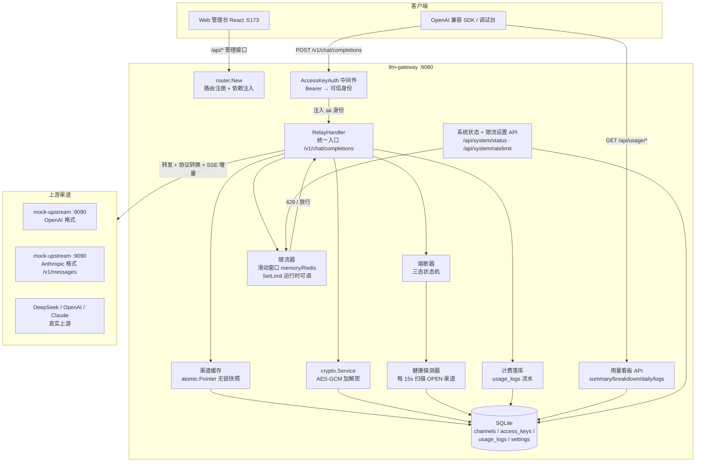
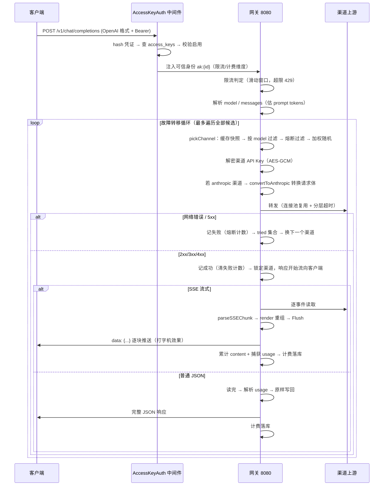

# LLM Gateway — AI 网关（Go 面试项目）

一个用 Go 从零实现的 **AI 网关（LLM Gateway）**：客户端只认一个 OpenAI 兼容入口，
网关负责把请求路由到背后多家大模型服务商（OpenAI / DeepSeek / Anthropic-Claude），
并完成密钥加密存储、协议互转、流式增量转换、故障熔断、限流、计费与用量看板。

同时配套一套 **Web 管理台**（React + Vite + TS）：总览 / 渠道管理 / 用量看板 /
AccessKey 签发 / 系统状态 / 请求日志 / 调试台，支持在页面上动态调整限流并持久化。

> 核心价值：**让上游协议的差异对客户端完全透明**——客户端永远只发 OpenAI 格式，
> 网关在内部完成 Anthropic ↔ OpenAI 双向转换（含流式），并在背后调度多个渠道。

---

## 目录

- [项目定位](#项目定位)
- [技术栈](#技术栈)
- [整体架构](#整体架构)
- [快速开始](#快速开始)
- [配置项](#配置项)
- [核心功能详解](#核心功能详解)
  - [1. 渠道管理 CRUD](#1-渠道管理-crud)
  - [2. API Key AES-GCM 加密落库](#2-api-key-aes-gcm-加密落库)
  - [3. 渠道配置热更新（无锁快照）](#3-渠道配置热更新无锁快照)
  - [4. 请求路由：按模型过滤 + 加权随机调度](#4-请求路由按模型过滤--加权随机调度)
  - [5. 单请求内故障转移](#5-单请求内故障转移)
  - [6. OpenAI ↔ Anthropic 协议转换（双向）](#6-openai--anthropic-协议转换双向)
  - [7. SSE 流式增量转换](#7-sse-流式增量转换)
  - [8. 熔断（三态状态机）+ 后台健康探测](#8-熔断三态状态机--后台健康探测)
  - [9. 转发连接池与分层超时](#9-转发连接池与分层超时)
  - [10. 滑动窗口限流（memory / Redis）](#10-滑动窗口限流memory--redis)
  - [11. Token 计费落库（流水表）](#11-token-计费落库流水表)
  - [11.1 计费落库的异步化（内存 channel / Redis Stream 双后端）](#111-计费落库的异步化内存-channel--redis-stream-双后端)
  - [11.2 模型单价管理（DB 配置化 + 内存缓存热更新）](#112-模型单价管理db-配置化--内存缓存热更新)
  - [12. 用量看板 API（查询时聚合）](#12-用量看板-api查询时聚合)
  - [13. AccessKey 鉴权（调用方可信身份）](#13-accesskey-鉴权调用方可信身份)
  - [14. 限流次数 Web 动态设置（settings 持久化）](#14-限流次数-web-动态设置settings-持久化)
  - [15. 请求日志与失败审计（失败也落库 + 链路/调用方/耗时维度）](#15-请求日志与失败审计失败也落库--链路调用方耗时维度)
  - [16. Web 管理台（React 液态玻璃）](#16-web-管理台react-液态玻璃)
    - [系统状态接口设计](#系统状态接口设计)
- [数据表设计](#数据表设计)
- [API 一览](#api-一览)
- [目录结构](#目录结构)
- [测试](#测试)
- [面试亮点速查](#面试亮点速查)

---

## 项目定位

```
┌────────────┐   OpenAI 格式    ┌─────────────┐   各家上游协议   ┌────────────────┐
│  客户端      │ ───────────────▶ │  llm-gateway │ ──────────────▶ │ OpenAI / DeepSeek│
│ (SDK/前端)  │ ◀─────────────── │  (8080)      │ ◀────────────── │ Anthropic/Claude│
└────────────┘   统一 OpenAI 格式 └─────────────┘   内部做协议互转  └────────────────┘
```

客户端只需要记住**一个地址、一种协议（OpenAI Chat Completions）**。
网关在背后：按模型挑渠道 → 解密渠道密钥 → （必要时）把请求翻译成上游协议 →
转发 → 把上游响应翻译回 OpenAI 格式 → 返回，同时完成熔断、限流、计费。

## 技术栈

| 层 | 选型 | 说明 |
|---|---|---|
| 语言 | Go 1.22+ | `math/rand/v2`、`atomic.Pointer`、`atomic.Int64` 等新特性 |
| Web 框架 | Gin | 路由、参数绑定、JSON 响应 |
| 数据库 | SQLite（`github.com/glebarez/sqlite`） | 纯 Go 驱动，免 CGO，Windows 直接可用；生产可平替 MySQL |
| ORM | GORM | AutoMigrate 建表、链式查询 |
| 加密 | `crypto/aes` + `crypto/cipher`（AES-256-GCM） | Go 标准库，零第三方依赖 |
| 缓存/限流 | 内存实现 + Redis（`go-redis/v9` + Lua 脚本） | 本地零依赖，生产切 Redis |
| 前端 | React 19 + Vite + TypeScript + framer-motion | Web 管理台（液态玻璃 + 黑紫风 + 顶部导航，风格参照 reactbits.dev） |
| 测试 | Go 标准 `testing` + `httptest` | 全包单测覆盖核心逻辑 |

## 整体架构



请求主链路（`/v1/chat/completions`）：



## 快速开始

需要两个终端：

```bash
# 终端 1：启动 mock 上游（本地假 LLM，:9090，提供 OpenAI + Anthropic 两种格式）
go run ./cmd/mockupstream

# 终端 2：启动网关（:8080）
go run ./cmd/server
```

> 注意：必须在项目根目录运行（SQLite 默认路径是相对路径 `data/llm-gateway.db`）。
> 首次启动自动建表（`channels`、`access_keys`、`usage_logs`、`settings`），无需手动初始化。

启动 Web 管理台（可选，第三个终端）：

```bash
cd web
npm install     # 首次
npm run dev     # http://localhost:5173（vite 代理 /api 与 /v1 → :8080）
```

> 前端构建注意：Windows 中文路径下 esbuild 会挂，构建前先
> `$env:TMP = $env:TEMP = 'E:\front\后端\llm-gateway\web\.esbuild-tmp'` 再 `npm run build`。

创建一个指向 mock 的渠道：

```bash
curl -X POST http://localhost:8080/api/channels \
  -H "Content-Type: application/json" \
  -d '{"name":"Mock 上游","provider":"openai","base_url":"http://localhost:9090/v1","api_key":"sk-mock-001","weight":1,"models":"mock-upstream","enabled":true}'
```

发一个请求：

```bash
curl http://localhost:8080/v1/chat/completions \
  -H "Content-Type: application/json" \
  -H "Authorization: Bearer sk-mock-001" \
  -d '{"model":"mock-upstream","messages":[{"role":"user","content":"你好"}]}'
```

流式请求加 `"stream": true` 即可看到打字机效果。更多用例见 `requests.http`。

## 配置项

全部通过环境变量配置（未设置走默认值，本地零依赖开箱即用）：

| 环境变量 | 默认值 | 说明 |
|---|---|---|
| `PORT` | `8080` | 网关监听端口 |
| `DB_PATH` | `data/llm-gateway.db` | SQLite 文件路径 |
| `LLM_GATEWAY_SECRET_KEY` | 开发默认密钥 | API Key 加密密钥（64 位 hex = AES-256）。**生产必须显式设置**，未设置时 main 会回退到开发默认值并打警告 |
| `RATE_LIMIT_ENABLED` | 开（显式 `"false"` 关） | 是否开启限流 |
| `RATE_LIMIT_PER_MIN` | `60` | 每调用方每分钟最大请求数（滑动窗口）。**仅启动默认**——在管理台保存过限流次数后，settings 表的值覆盖它（重启保留） |
| `RATE_LIMIT_STORE` | `memory` | `memory`（本地单机）/ `redis`（多实例共享） |
| `REDIS_ADDR` | `localhost:6379` | `store=redis` 或日志后端 `=redis` 时的 Redis 地址 |
| `USAGE_LOG_BACKEND` | `memory` | 计费落库后端：`memory`（进程内 channel）/ `redis`（Redis Streams 消费组） |
| `REQUEST_LOG_DIR` | `data/request-logs` | 请求级日志根目录（每条请求一个文件：`{dir}/{date}/{requestID}.log`） |

示例：`$env:LLM_GATEWAY_SECRET_KEY = "<64 位 hex>"; $env:RATE_LIMIT_PER_MIN = 3; go run ./cmd/server`

---

## 核心功能详解

### 1. 渠道管理 CRUD

`internal/handler/channel.go`，五个端点：

| 方法 | 路径 | 说明 |
|---|---|---|
| GET | `/api/channels` | 列表 |
| POST | `/api/channels` | 创建（密钥加密后入库） |
| GET | `/api/channels/:id` | 详情 |
| PUT | `/api/channels/:id` | 更新（map 更新 + 显式三态） |
| DELETE | `/api/channels/:id` | 删除 |

**实现要点：**

- **模型与视图分离**：`model.Channel` 的 `APIKey` 字段可以正常进出（存储层需要），
  响应层用 `channelView` 手动挑选字段返回，**密钥永远不出现在接口响应里**。
  这是为了绕开 `json:"-"` 的"双向屏蔽"陷阱（它会连请求体解析一起挡掉，导致密钥存不进去）。
- **GORM 零值陷阱**（面试高频考点）：
  - `Create` 时 `Enabled bool` 传 `false` 会被带 `default:true` 标签的数据库默认值吞成 `true` →
    用 `*bool`（指针）区分「没传 / 显式 false / 显式 true」三种状态；
  - `Update` 用结构体会忽略零值（`weight=0`、`enabled=false` 更新不进去）→ 改用 `map` 更新；
  - `enabled` 只有显式传了才写（修复旧实现"任何不带 enabled 的 PUT 都把渠道禁用"的 bug）；
  - `api_key` 留空 = 不更新（防止没传密钥把库里的密钥清空）。

### 2. API Key AES-GCM 加密落库

`internal/crypto/crypto.go`。渠道的 `api_key`（sk-xxx）是上游的"钱袋子"，
明文落库等于"拖库即失守"，所以落库前加密、转发前解密。

```
Encrypt: 随机 nonce(12B) + GCM Seal → hex(nonce ‖ 密文 ‖ tag)
Decrypt: hex 解码 → 拆 nonce → GCM Open（校验完整性）
```

- **为什么 AES-GCM**：AEAD 认证加密——密文被篡改一个字节，解密直接报错而非解出乱码；
  Go 标准库原生支持，零依赖。
- **随机 nonce 前置**：同一明文两次加密结果完全不同（防重放、防密文模式泄露）；
  nonce 无需保密，随密文一起存。
- **上下文 AAD（域隔离）**：`contextAAD = "llm-gateway/channel-api-key/v1"` 参与认证，
  即使两个系统误用同一把密钥，也彼此解不开对方的密文。
- **密钥派生**：64 位 hex → 直接解码为 32 字节（AES-256）；其他非空字符串 → SHA-256 压缩；
  空串 → 直接报错（拒绝"没密钥就加密"）。
- **旧数据兼容**：`DecryptOrRaw` 对"看着不像密文"的数据（老库里的明文 sk-xxx）原样返回，
  迁移期不炸。
- **接口依赖倒置**：`Service` 是接口，业务层只依赖接口——未来换 KMS / 信封加密，
  handler 一行不用改。

### 3. 渠道配置热更新（无锁快照）

`internal/handler/channel_cache.go`。

**问题**：真实网关的渠道表在 MySQL，每请求查库 = 每请求一次网络往返 + 数据库压力。

**方案**：内存快照 + `atomic.Pointer` Copy-on-Write：

- 启动 / 每 30s 轮询，把「启用渠道」整份载入内存，构建**不可变快照**；
- 请求路径 `snap.Load()` 一条原子读指令，**无锁**；
- 渠道增删改后 `Refresh()` 换新指针，读者要么拿到旧快照要么拿到新快照，
  **永远是一份完整一致的切片**（不会读到半份数据）；
- 后台 ticker 兜底（渠道被外部直接改库时也能感知）。

**为什么不用 RWMutex**：每请求 `RLock/RUnlock` 有锁开销和缓存行争用；
`atomic.Pointer` 的 Load 是无锁原子读，更新只换指针（写少读多天然适合）。

### 4. 请求路由：按模型过滤 + 加权随机调度

`internal/handler/relay.go` → `pickChannel`。三层过滤 + 加权随机：

```
快照里的启用渠道
  ├─ 排除：已试过且失败的渠道（tried 集合）
  ├─ 过滤：渠道 models 白名单不含请求模型 → 跳过（空 = 支持所有）
  ├─ 过滤：熔断状态 OPEN（冷却中）/ HALF_OPEN（已放行探测）→ 跳过
  └─ 加权随机（前缀区间法）：
       权重 [1,2,3] → 总权重 6 → 随机数 n∈[0,6) 落在哪段选谁
```

- **按模型路由**：渠道 `models` 字段（逗号分隔白名单）决定它服务哪些模型；
  请求 `model=claude-3-5-sonnet` 只有声明支持该模型的渠道才进候选池。
- **加权随机**：权重高的渠道被选中概率大（可做成本/性能倾斜），
  前缀区间法 O(n) 一次遍历完成选择。

### 5. 单请求内故障转移

同一请求内，网络错误 / 5xx / 密钥解密失败 → 记入 `tried` 集合 → 换下一个渠道重试，
直到所有候选试完（502「所有渠道均不可用」）或压根没渠道（503「无可用渠道」）。

**关键边界（面试必讲）**：只能在「拿到上游响应之前」切换渠道。
一旦拿到响应（哪怕只是响应头），客户端就开始消费数据——
此时再换渠道重试，客户端会收到"半截回复 + 另一个渠道的回复"，比失败更糟。
所以拿到响应 → 立即锁定透传，绝不再切换（SSE 尤其如此）。

4xx 不重试：400 是请求体坏、401 是密钥错、404 是路径错——换任何渠道结果都一样。

### 6. OpenAI ↔ Anthropic 协议转换（双向）

三个转换点，覆盖请求侧与响应侧、流式与非流式。每个转换点都给出**输入 → 输出**对照。

**① 请求侧 `convertToAnthropic`（OpenAI 请求 → Anthropic 请求）**

客户端发来（输入，OpenAI 格式）：

```json
{
  "model": "claude-3-5-sonnet",
  "messages": [
    { "role": "system", "content": "你是翻译助手" },
    { "role": "user",   "content": "翻译 hello" }
  ],
  "stream": true
}
```

网关转发给 Anthropic 上游的（输出）：

```json
{
  "model": "claude-3-5-sonnet",
  "max_tokens": 1024,
  "system": "你是翻译助手",
  "messages": [
    { "role": "user", "content": "翻译 hello" }
  ],
  "stream": true
}
```

转换点：

| # | 输入（OpenAI） | 输出（Anthropic） | 原因 |
|---|---|---|---|
| 1 | `messages[]` 里 role=system 的消息 | 拆出为顶层 `system` 字段 | Anthropic 协议要求 system 在顶层，messages 里不能有 system |
| 2 | （客户端没传） | `max_tokens: 1024` 补齐 | Anthropic 的 max_tokens 是**必填**，OpenAI 可选 |
| 3 | `messages[]` 全部角色 | 只保留 user / assistant | Anthropic 消息角色受限（system 已拆走） |
| 4 | `model`、`stream` | 原样透传 | 两边语义一致 |

**② 响应侧流式 `parseSSEChunk`（双协议解析 → 统一 OpenAI 事件）**

上游是 **Anthropic** 时，流里来的是** 6 种事件**（逐条出现，无 `[DONE]` 收尾）：

```json
// ① message_start：会话开始（带预估用量 input_tokens=12 → 网关提取作为 prompt tokens；无增量 → 不透传正文）
data: {"type":"message_start","message":{"id":"msg_01ABC","type":"message","role":"assistant","content":[],"model":"claude-3-5-sonnet","usage":{"input_tokens":12,"output_tokens":1}}}

// ② content_block_start：第一个文本块开始（无增量 → 网关跳过）
data: {"type":"content_block_start","index":0,"content_block":{"type":"text","text":""}}

// ③ content_block_delta × N：逐字增量（打字机本体，网关唯一透传的正文）
data: {"type":"content_block_delta","index":0,"delta":{"type":"text_delta","text":"你好"}}
data: {"type":"content_block_delta","index":0,"delta":{"type":"text_delta","text":"，"}}

// ④ content_block_stop：文本块结束（无增量 → 网关跳过）
data: {"type":"content_block_stop","index":0}

// ⑤ message_delta：结束原因 + 顶层 usage.output_tokens=10（最终生成量 → 网关提取作为 completion tokens）
data: {"type":"message_delta","delta":{"stop_reason":"end_turn","stop_sequence":null},"usage":{"output_tokens":10}}

// ⑥ message_stop：会话结束（对应 OpenAI 的 [DONE]；无增量 → 网关跳过）
data: {"type":"message_stop"}
```

网关写给客户端的（输出，统一 OpenAI 格式）——6 种里只有 ③ 和 ⑤ 产生输出：

```json
data: {"choices":[{"index":0,"delta":{"content":"你好"}}]}
data: {"choices":[{"index":0,"delta":{"content":"，"}}]}

data: {"choices":[{"index":0,"delta":{},"finish_reason":"stop"}]}
```

转换点：

| #   | 输入（Anthropic）                                                                   | 输出（OpenAI）                  | 说明                                 |
| --- | ------------------------------------------------------------------------------- | --------------------------- | ---------------------------------- |
| 1   | `delta.text`（content_block_delta 里）                                             | `delta.content`             | 增量文本字段改名                           |
| 2   | `delta.stop_reason`（message_delta 里）                                            | `finish_reason`             | 结束原因，经 `mapAnthropicStopReason` 映射 |
| 3   | `stop_reason: end_turn`                                                         | `finish_reason: stop`       | 正常结束                               |
| 4   | `stop_reason: max_tokens`                                                       | `finish_reason: length`     | 输出截断                               |
| 5   | `stop_reason: tool_use`                                                         | `finish_reason: tool_calls` | 工具调用                               |
| 6   | `message_start` / `content_block_start` / `content_block_stop` / `message_stop` | 无输出（跳过）                     | 无增量事件，不透传                          |
| 7   | `message_start.usage.input_tokens` + `message_delta.usage.output_tokens`        | 合并成完整 usage（透传末尾 + 计费用）   | Anthropic 用量分散两条事件：`parseSSEChunk` 各取一段，`forwardSSE` 用 `mergeSSEUsage` 拼成 `{12,10,22}`；message_start 的 `output_tokens` 是预估上限**忽略**，只信 message_delta 的真实值；流末补发一条完整 usage 事件覆盖中间的半对值 |

解析流程：先探测 `type` 字段（有 = Anthropic 事件，无 = OpenAI 格式）→ 提取增量 →
统一塞进语义层 `sseChunk{index, content, finishReason, usage}` → `render()` 重组成上面的 OpenAI 事件。

**③ 响应侧非流式 `convertAnthropicOnce`（Anthropic JSON → OpenAI 格式）**

上游返回（输入，Anthropic 非流式）：

```json
{
  "id": "msg_01ABC",
  "type": "message",
  "model": "claude-3-5-sonnet",
  "content": [
    { "type": "text", "text": "你好，" },
    { "type": "text", "text": "世界！" }
  ],
  "stop_reason": "end_turn",
  "usage": { "input_tokens": 12, "output_tokens": 10 }
}
```

网关写给客户端的（输出，OpenAI 非流式）：

```json
{
  "id": "msg_01ABC",
  "object": "chat.completion",
  "model": "claude-3-5-sonnet",
  "choices": [
    {
      "index": 0,
      "message": { "role": "assistant", "content": "你好，世界！" },
      "finish_reason": "stop"
    }
  ],
  "usage": { "prompt_tokens": 12, "completion_tokens": 10, "total_tokens": 22 }
}
```

转换点：

| # | 输入（Anthropic） | 输出（OpenAI） | 说明 |
|---|---|---|---|
| 1 | `content[]` 多个 text 块 | 拼接成一个 `choices[0].message.content` | "你好，" + "世界！" → "你好，世界！" |
| 2 | `stop_reason: end_turn` | `finish_reason: stop` | 同上映射表 |
| 3 | `usage.input_tokens` | `usage.prompt_tokens` | 字段改名 |
| 4 | `usage.output_tokens` | `usage.completion_tokens` | 字段改名 |
| 5 | （无） | `object: "chat.completion"` | 补 OpenAI 格式标记 |
| 6 | `id` / `model` | 原样透传 | 保留可追溯性 |

协议差异对照：

| 维度 | OpenAI | Anthropic |
|---|---|---|
| 请求路径 | `/chat/completions` | `/messages` |
| 鉴权头 | `Authorization: Bearer` | `x-api-key` + `anthropic-version` |
| system 位置 | messages 数组里 | 顶层 `system` 字段 |
| max_tokens | 可选 | **必填** |
| 流式事件 | `data: {choices:[{delta:{content}}]}` + `[DONE]` | 6 种事件：`message_start / content_block_start / content_block_delta ×N / content_block_stop / message_delta / message_stop`（无 `[DONE]`） |
| 结束原因 | `finish_reason: stop/length/tool_calls` | `stop_reason: end_turn/max_tokens/tool_use` |

### 7. SSE 流式增量转换

`internal/handler/relay.go` → `forwardSSE` / `handleSSEEvent` / `parseSSEChunk` / `render`。

**为什么不能 `io.Copy` 纯透传**：上游（Anthropic 等）的流式格式和 OpenAI 不一样，
纯透传 = 客户端收到看不懂的格式；必须**边收边转**——每个 chunk 解析出增量字段，
重组成 OpenAI 格式再写给客户端。

三个技术点（面试必讲）：

1. **拆包缓冲（TCP 字节流 → 按空行切事件）**：

   TCP 是**字节流，没有消息边界**——上游写进连接的一串字节，到达网关时会被网络栈
   任意切成若干包：一条事件可能被拆成两段（拆包）、多条事件可能粘在一起同时到（粘包）。
   SSE 协议的边界约定是**空行（`\n\n`）**：`data: {...}` 一行 + 一个空行 = 一条事件。

   ```go
   reader := bufio.NewReader(upResp.Body) // 带缓冲读取器
   var event []byte                        // 攒包缓冲
   for {
       line, _ := reader.ReadBytes('\n')   // 读到 \n 才返回一行；半行到达则阻塞等下一段
       event = append(event, line...)      // 拼进缓冲
       if len(bytes.TrimSpace(line)) == 0 { // 空行 = 一条事件完整了
           handleSSEEvent(c, event)        // 切出这条事件去解析/转换
           event = event[:0]               // 清空（复用底层数组，避免流式高频分配）
       }
   }
   ```

   效果：**拆包不丢**（半行会一直攒到补完整行）、**粘包不乱**（攒够空行才切一条，
   多余字节留到下轮继续攒）。这是 SSE 客户端/网关的标配处理，面试可直接讲这个循环。
2. **增量映射（双协议 → 统一语义层 `sseChunk`）**：
   解析 `data:` 里的 JSON，**只搬三类字段**：增量文本 / 结束原因 / 用量，
   其余 JSON 骨架（id、index、type、role 等）一律丢弃，重组成 OpenAI 格式再写回。

   | 源事件 | 提取 | 去往 |
   |---|---|---|
   | OpenAI `delta.content` | 增量文本 | `sseChunk.content` → `delta.content` |
   | OpenAI `finish_reason` | 结束原因 | `sseChunk.finishReason`（原样透传） |
   | OpenAI `usage` | 完整用量（单条） | `sseChunk.usage`（透传 + 计费） |
   | Anthropic `content_block_delta.delta.text` | 增量文本 | `sseChunk.content` → `delta.content` |
   | Anthropic `message_delta.delta.stop_reason` | 结束原因 | 经 `mapAnthropicStopReason` 映射 |
   | Anthropic `message_start.usage.input_tokens` + `message_delta.usage.output_tokens` | 用量**两段分散** | `mergeSSEUsage` 合并成完整 usage（计费 + 流末补发） |

   **哪些事件被跳过**：`content_block_start` / `content_block_stop` / `message_stop`
   ——无增量、无用量，返回空 chunk，不透传给客户端；`message_start` 不透传正文，
   但提取 input_tokens 用于计费（其 output_tokens 是预估上限，**忽略**）。
3. **半途断连**：客户端断开 → 写入报错 → 停止读取，上游的 context 随之取消（链路自动回收）。

另外两个协议补齐：
- **`[DONE]` 补发**：OpenAI 客户端等 `data: [DONE]` 收尾；Anthropic 流用 `message_stop` 结束、
  没有 `[DONE]` → 网关在 EOF 时若未发过 `[DONE]` 就补一个；
- **顺序坑**：必须先 `Header` 再 `Status`——`c.Status()` 会立即发出响应头，
  后设的 `Content-Type: text/event-stream` 会丢失（HTTP 头只发一次）。

### 8. 熔断（三态状态机）+ 后台健康探测

`internal/handler/circuit_breaker.go` + `health_probe.go`。

**状态机**：

```
CLOSED（正常，参与调度）──连续失败≥3次──▶ OPEN（熔断摘除）
OPEN（冷却 30s 过后被允许）───────▶ HALF_OPEN（半开）
HALF_OPEN 探测成功 ──▶ CLOSED（恢复调度）
HALF_OPEN 探测失败 ──▶ OPEN（继续熔断，重记冷却）
```

- **每个渠道一个熔断器**（懒创建注册表），`sync.Mutex` 保护并发读写；
- `allow`：OPEN 冷却中 → 拒绝；冷却过了 → 转 HALF_OPEN 并**放行 1 个探测请求**；
  HALF_OPEN 只放行 1 个（避免恢复瞬间被并发请求打爆），其余拒绝；
- `recordFailure`：连续失败累计，达阈值（3 次）→ OPEN；HALF_OPEN 下探测失败立即回 OPEN；
- `recordSuccess`：清失败计数；HALF_OPEN → CLOSED；
- **哪些算失败**（relay 接入点）：网络错误 / 5xx / 密钥解密失败；
  4xx 记成功（请求本身的问题，不是渠道故障）。

**两条恢复路径（面试讲点）**：
1. **被动**：冷却期后转半开，放行 1 个真实请求"试水"，成功即恢复；
2. **主动**：后台健康探测器每 15s 扫描所有 OPEN 渠道，`GET {base_url}/health`，
   返回 <500 直接 `probeOK` 恢复（跳过半开等待）。

### 9. 转发连接池与分层超时

`internal/handler/relay.go` → `NewRelayHandler`。

```
http.Transport{
  MaxIdleConns:        100,   // 全局最大空闲连接
  MaxIdleConnsPerHost: 10,    // 单上游空闲连接（默认 2 → 10）
  IdleConnTimeout:     90s,   // 空闲回收
  ResponseHeaderTimeout: 30s, // 等响应头上限
  DialContext.Timeout:  10s,  // 建连上限
}
http.Client{ Timeout: 0 }     // 禁用整体超时！
```

**为什么 `Client.Timeout=0`**：SSE 流式是"无限长"的——上游思考 40s 才吐第一个 token
很正常，整体超时会掐断已经开始的数据流。分层超时已经兜住"上游不理我们"
（建连 10s / 响应头 30s 超时），流开始后不设上限。

### 10. 滑动窗口限流（memory / Redis）

`internal/ratelimit/`。为什么滑动窗口而不是固定窗口：
固定窗口（INCR + EXPIRE）在边界有突刺——59:59 用满 100 次，60:00 重置又能用满 100 次，
一瞬间放行 200 次；滑动窗口按每个请求的真实时间戳统计"最近 window 内的次数"，没有突刺。

**memory 版**（`memory.go`）：`map[key][]time.Time`，每次 Allow：
1. 清掉窗口外时间戳（旧请求"滑出"窗口，`kept := hits[:0]` 复用底层数组零拷贝过滤）；
2. 剩余数 ≥ limit → 拒绝；否则记录本次时间戳 + 放行。

**Redis 版**（`redis.go`）：ZSET + Lua 单脚本原子完成：

```
ZREMRANGEBYSCORE key 0 now-window   -- 清过期
ZCARD key                           -- 数窗口内个数
ZADD key now member                 -- 记录本次请求（member="毫秒时间戳:随机串"，防同毫秒覆盖）
PEXPIRE key window+1000             -- 防 key 永不删除
```

- **ZSET**：member = 请求唯一标识，score = 时间戳（毫秒）——天然表达滑动窗口；
- **Lua 原子性**：Redis 单线程执行整个脚本，并发请求不会出现"两个都查到 count=99 都放行"的竞态；
- **超时预算**：`Allow` 单次 500ms 超时（正常亚毫秒级，只有 Redis 故障才触达）；
- **fail-open**：限流器自身故障（Redis 连不上）→ 放行 + 打日志，
  绝不让"限流组件挂了"拖垮整个网关（可用性优先）；
- **限流维度**：`Authorization: Bearer <key>` → `X-User-Key` → 客户端 IP 兜底
  （真实网关替换为鉴权后的可信身份；本仓库接入 AccessKeyAuth 后维度即 `ak:{id}`）；
- **接入点**：`ChatCompletions` 解析 body **之前**先掐限流（省得为被拒请求白做 JSON 解析）。

**运行时调整 + 持久化（第 14 节配套）**：`Limiter` 接口除 `Allow` 外暴露
`SetLimit(limit)` / `Limit()`——memory 用 `sync.Mutex` 保护，redis 用 `atomic.Int64`
无锁读写（Lua 每次取 `Load()`，改小立即生效：存量时间戳超过新上限的请求下次判定直接被拒）。
上限值存 `settings` KV 表，重启自动恢复（见第 14 节）。

### 11. Token 计费落库（流水表）

`internal/model/usage_log.go` + `internal/usage/` + `recordUsage`。

**设计原则（面试讲点）**：流水表 + 查询时聚合——
每次请求 INSERT 一条（只增不减，可审计），聚合由看板查询时算；
不维护"每渠道一个计数行 + 每请求 UPDATE"（热点行锁：所有请求抢同一行写锁，并发越高越慢）。

**三个响应分支统一接入，口径一致（真值优先，缺失时估算兜底）：**

| 分支 | usage 来源 | 缺失兜底 |
|---|---|---|
| SSE 流式 | `forwardSSE` 合并 usage：OpenAI 单条事件 / **Anthropic 的 message_start(input)+message_delta(output) 两段合并** | completion 按累计文本估算、prompt 按请求文本估算（两者都拿不到 usage 时才兜底） |
| 非流式 OpenAI | 解析响应体 `usage` | completion 按 `choices[0].message.content` 纯文本估算 |
| 非流式 Anthropic | 转换返回 `input/output_tokens` | completion 按响应文本估算 |

**估算器 `EstimateTokens`**（启发式，不用真 tokenizer）：
- ASCII（英文/数字/符号）约 4 字符 = 1 token；
- 非 ASCII（中文等）1 字 ≈ 1 token。
- 口径只求量级正确（真实精度用 tiktoken，这里兜底够用）。

**计价 `CalcCost`**：单价从 `model_pricing` 表（管理台可配，元/1K token）经
`PricingCache` 内存缓存读取，两级匹配：精确模型名 → 默认价兜底
（未配置的模型按默认低价 0.002/0.002 计费，管理台显式添加即可精确计费）。

> 踩坑记录：估算 completion 不能按"整个响应体 JSON"——
> id/object/role/finish_reason 这些 JSON 骨架不是模型输出，会把 completion 高估 2~3 倍；
> 三个分支统一估"模型输出的纯文本"。

### 11.1 计费落库的异步化（内存 channel / Redis Stream 双后端）

**已实现**：`internal/handler/usage_writer.go`（内存版）+ `usage_writer_redis.go`（Redis Stream 版），
通过 `USAGE_LOG_BACKEND` 环境变量切换（默认 `memory`）。

**为什么异步**：同步记账时 `recordUsage` 的 `db.Create` 在 handler 返回**之前**执行，
客户端要等落库完成才收到最终响应。三个具体问题：

| 问题 | 说明 |
|---|---|
| 客户端为记账买单 | 响应内容已就绪，但 handler 不返回——落库每次多等一次磁盘确认（fsync），QPS 越高 db 越忙，等待越长 |
| 转发成功 ≠ 记账成功 | 上游返回 200、响应已写完，落库若失败（锁冲突/磁盘满）只记一行日志，**流水永久丢失** |
| 每请求一次 db 写 | 每条请求一个 `db.Create`，QPS 上来后 db 写成为网关瓶颈 |

**解耦方案（事件投递 + 后台批量落库）**：

```
请求路径：转发 → 写响应 → 丢记账事件进队列 → 立即返回（毫秒级）
                              │
              队列（Go channel → Redis Streams → Kafka，按需演进）
                              ▼
后台 worker：攒批 → 批量 INSERT（1 次事务 = N 条流水，1 次 fsync）
```

收益：客户端不等记账；落库失败可重试/重放（队列保留事件）；批量写把 N 次
"随机小写 + N 次等确认"合并成 1 次"顺序大写 + 1 次等确认"——数据库本质
仍要落盘，但请求不再等这个确认。

**两个后端对比（面试讲点）**：

| 维度 | memory（进程内 channel） | redis（Redis Streams） |
|---|---|---|
| 依赖 | 零 | 需要 Redis |
| 队列 | 内存 channel，容量 256，满则丢弃计数（fail-open） | Redis Stream `usage_logs` + 消费组 `logs-worker` |
| 批量 | 攒 32 条 / 500ms flush | XREADGROUP 最多读 32 条，阻塞 500ms |
| 可靠性 | 进程崩溃丢队列中未落库事件 | 未 ACK 的消息留在 pending 列表，重启可重读 |
| 多实例 | 各自独立队列（互不相通） | 共享 Stream，消费组内多实例分担消息 |
| 关闭 | Close() 优雅 drain 剩余 batch 再退出 | 同样 drain + ACK |

系统状态页「异步落库」卡片展示后端类型 + 入队数 / 已落库数 / 丢弃数 / 写失败数 / 队列深度。

> 面试讲法："同步记账 = 让算账的人挡住客人的门。响应完成是主流程，记账是
> 附属流程，附属流程不该决定主流程何时结束。解耦 = 请求路径只描述事实并
> 投递，后台慢慢算——这是队列存在的意义。"

### 11.2 模型单价管理（DB 配置化 + 内存缓存热更新）

`internal/model/model_pricing.go` + `internal/usage/pricing_cache.go` + `internal/handler/model_pricing.go`。

**为什么配置化**：单价原本硬编码在 `internal/usage/price.go` 的 map 里，改价格 = 改代码 + 重启。
单价是**低频变更的高频读**数据——放进 DB + 内存缓存，管理台改价立即生效。

```
管理台 CRUD ──▶ model_pricing 表 ──▶ Refresh() 全量加载 ──▶ PricingCache 内存快照
                                                              │
请求转发时 CalcCost ──▶ Lookup(model)（RWMutex 无锁读）──▶ 精确匹配 → 默认兜底
```

设计要点：

- **表**：`model_pricing`（model_name 唯一索引 / input_price / output_price / enabled）
- **缓存**：RWMutex 保护快照 map，读路径无锁；管理台 CRUD 后主动 `Refresh()`
- **种子数据**：首次启动（表为空）写入 7 条默认单价（deepseek-chat 0.14/0.28、gpt-4o 0.018/0.072、claude-3-5-sonnet 0.022/0.088 等）
- **查找策略**：精确匹配 → 默认兜底（0.002/0.002），**不做前缀匹配**——新模型未配单价显式走默认价，管理台添加后精确计费，避免"偷偷套用同厂商价格"的隐性计费错误
- **建表位置**：统一收口 `storage.InitDB` 的 AutoMigrate（不散落在 router）
- **前端**：`/pricing`「模型单价」页——列表 / 新增 / 编辑 / 启停 / 删除（自定义确认弹窗）

> 面试讲点：单价缓存复用渠道缓存的同一套模式（快照 + RWMutex + CRUD 后主动刷新），
> 面试可对比"每次请求查 DB"（慢）vs"缓存 + 失效刷新"（快）vs"配置中心推送"（生产演进方向）。

### 12. 用量看板 API（查询时聚合）

`internal/handler/usage_dashboard.go`，四个端点：

| 端点 | 用途 | 返回 |
|---|---|---|
| `GET /api/usage/summary?days=7` | 总览卡片 | 请求数 / prompt+completion+total tokens / 费用 |
| `GET /api/usage/breakdown?group=model\|channel&days=7` | 分组排行 | 按模型或渠道聚合，按费用降序 |
| `GET /api/usage/daily?days=7` | 按天趋势 | 时间序列（折线图数据），升序 |
| `GET /api/usage/logs?page=&page_size=&model=&channel_id=&provider=&days=` | 请求日志 | 明细分页（`{total,page,page_size,items}`，按 created_at 降序） |

实现细节：
- **GROUP BY + SUM 查询时聚合**：`count(*)`、`coalesce(sum(tokens),0)`、`coalesce(sum(cost),0)`；
- **`coalesce` 兜底**：SQLite 空表 `SUM` 返回 NULL 而非 0，coalesce 保证空库也返回全 0（不 500）；
- **`group` 参数白名单**：只允许 `model` / `channel_name` 两个预定义列名，
  用户输入塞不进 SQL（防注入）；
- **流水冗余 `channel_name`**：按渠道分组免 JOIN 渠道表（省一次查询）；
- **`days` 参数**：默认 7，范围 1~90；
- 踩坑记录：GORM `Scan` 到**内嵌结构体**时聚合列映射失效（分组键对、数值全 0）→ 平铺字段解决；
- **响应无 `code/data` 包装**：usage 类接口直接返回聚合体（与渠道管理接口的 `resp()` 包装风格区分，前端各自解析）。

### 13. AccessKey 鉴权（调用方可信身份）

`internal/handler/access_key.go`。解决"客户端自报身份不可信"问题——
限流/计费的维度不能信请求头里自己写的值，必须由网关签发、校验过的凭证决定。

**签发体系（`access_keys` 表）：**

| 字段 | 说明 |
|---|---|
| `key_hash` | 明文 Key 的 SHA-256 哈希（**永不存明文**，拖库也拿不到可用 Key） |
| `scopes` | 授权模型列表（逗号分隔；为空 = 该 Key 不限定，覆盖所有模型） |
| `enabled` | 启用开关（停用 = 即时软吊销，已签发 Key 立即失效） |
| `last_used_at` | 最近使用时间（可审计；1 分钟节流更新，防无效 Key 刷脏数据） |

**Key 格式**：`sk_lgw_` + 32 字节随机数（hex 64 位），前缀便于识别与吊销归类；
明文只在**签发接口返回一次**，此后任何接口都只出哈希。

**中间件 `AccessKeyAuth`（gin.HandlerFunc，返回函数给路由注册）：**

```
请求进入
  → parseRequestModel(c)  // 偷看 body 里的 model（读完恢复 body，relay 还能再读）
  → modelProtected(db, modelName)?  // 该模型是否被任一启用 Key 的 scopes 覆盖
      ├─ 否（未受保护模型）→ 匿名放行 → Next()
      └─ 是 → 有 Bearer 吗？
            ├─ 无 → 401（且失败也落库）
            └─ 有 → hashAccessKey(plain) → db 查 key_hash
                  ├─ 未命中 / 停用 → 401（且失败也落库）
                  └─ 命中 && enabled → 注入 c.Set("ak", {id,name,scopes})
                        → scope 模型校验：scopes 空/"*"=全放行；
                          否则请求 model 不在 scopes → 403（落库带越权 key 身份）
                        → 放行 → Next()
```

**模型级鉴权语义（面试必讲）**：`scopes` 覆盖的模型要求 Bearer；
未被任何启用 Key 覆盖的模型允许匿名（裸测通道）；但**凭证无效一律 401**
（不能因为"这个模型开放匿名"就放行坏 Key——那是认证绕过）；
**凭证有效但越权（model 不在 scopes 里）一律 403**——401 是"你是谁"，403 是"你无权干这个"。
限流维度用鉴权后的 `ak:{id}`（可信身份），匿名才退化为 IP。

### 14. 限流次数 Web 动态设置（settings 持久化）

`internal/handler/ratelimit_admin.go` + `internal/model/setting.go` + `Limiter.SetLimit`。

**接口**：

| 方法 | 路径 | 说明 |
|---|---|---|
| GET | `/api/system/ratelimit` | 当前限流配置（enabled / store / limit_per_min / persisted / redis_addr） |
| PUT | `/api/system/ratelimit` | `{"per_min": N}` 运行时改上限 + 落库（参数错误返回真 HTTP 400） |

### 第 15.1 节 日志文件下载（管理台"请求日志"页）

请求级日志落盘后，管理后台可直接下载文件（请求日志按条、全局日志按天）：

| 方法 | 路径 | 说明 |
|---|---|---|
| GET | `/api/logs/files` | 文件列表：`global`（全局日志，存在才返回）+ `files[]`（请求日志，按日期倒序，含 `rel_path`/`size`/`mod_time`） |
| GET | `/api/logs/files/download?file=` | 下载附件。`file=global` 或 `file=2026-10-25/req_xxx.log` |

**安全边界**（下载接口核心，面试讲点）：前端只传**相对路径**，服务端三重校验——
① 后缀必须是 `.log`；② 显式拒绝 `/` `\` 开头（Windows 的 `filepath.IsAbs` 只认盘符，`/x` 不算绝对路径的坑）；③ Clean 后必须恰好是两层 `{date}/{requestID}.log` 且 `filepath.Rel` 仍在根目录内——`../`、深层、裸文件名、绝对路径一律 400。测试：`logfile_test.go` 覆盖穿越/越层/后缀三组用例。

全局日志 `data/logs/global.log` 由 `cmd/server/main.go` 启动时 `log.SetOutput(io.MultiWriter(os.Stdout, f))` tee 落盘（失败静默，不阻塞启动）。

**持久化优先级**（三层，面试讲点）：

```
默认配置（env/60） → settings 表（Web 保存过则覆盖默认，重启保留） → 运行时 SetLimit
```

- `settings` 是通用 KV 表（`Key` 主键 / `Value` 字符串 / `UpdatedAt`）；
  `ratelimit_per_min` 一行存"上次 Web 保存的限流次数"，**改动立即生效且重启不丢**；
- 启动时 `router.New` 读 settings 覆盖默认值再建限流器（env 只在从未设置时生效）；
- 系统状态接口的 `rate_limit.enabled / limit_per_min` 改为**实时生效值**
  （`limiter.Limit()`，而非启动时 cfg 快照），另返回 `persisted` 字段——
  前端凭它展示「重启保留」徽标 vs「默认值」，让"重启不丢"可见。

### 15. 请求日志与失败审计（失败也落库 + 链路/调用方/耗时维度）

`usage_logs` 从"计费流水"升级为"**请求审计**"：原则是**所有请求都留痕**——
不只是成功转发的，失败请求零痕迹 = 无法审计、无法复盘。

**失败也落库**：`status int`（成功 = 200）、`error varchar(500)`（失败摘要）。
覆盖的失败分支：429 限流 / 400·403 上游拒绝 / 502 全部渠道失败 / 503 无可用渠道 /
SSE 中断 / 协议转换失败 / 读响应体失败 / 上游 ≥400 / AccessKey 401（无凭证 + 凭证无效）。
抽取包级 `logUsageFailure(db, ch, model, status, errMsg)` 统一落库，
`upstreamErrorSummary` 提取上游 `{"error":{"message"}}` 原文摘要（截断 ≤500）。

**审计维度三期**（每条记录回答"谁、什么请求、什么时候、花了多久"）：

| 维度 | 字段 | 说明 |
|---|---|---|
| 链路 ID | `request_id` | `req_` + 12 字节 crypto/rand（hex 28 字符）；`AccessKeyAuth` 入口首行生成，**401 也有 ID**；同一请求跨日志/排障可关联 |
| 调用方 | `access_key_id` / `access_key_name` | 鉴权后注入的可信身份（0 = 匿名）；由 `auditMeta(c)` 一次取四元组 |
| 客户端 IP | `client_ip` | 调用方来源（IPv6 最长 45 字符） |
| 总耗时 | `duration_ms` | 请求进入 → 落库（毫秒），排障"慢"用 |
| 首响应延迟 | `first_response_ms` | ≈ TTFT：流式 = 首个增量 token 写出时刻；非流式 = 上游响应到达（`Do` 返回）。**mark 时直接算差值存 int64**（非存时间点事后算），失败分支不 mark = 0 语义正确 |

日志 API（`GET /api/usage/logs`）新增筛选参数：`request_id`（精确查链路）、
`access_key_name`（按调用方）、`client_ip`（按来源 IP）。前端日志页配套：
链路 ID hover 复制按钮（`navigator.clipboard` 优先 + textarea 兜底）、三个筛选输入框、
耗时列（`2.2s · 首 207ms`，<1ms 显示 `<1ms`——本地回环 TTFT 毫秒内取整 0 是真实值而非漏算）。

与计费流水的区别：**流水回答"花了多少钱"，日志回答"发生了什么"**——一张表两用。

### 16. Web 管理台（React 液态玻璃）

`web/`（React 19 + Vite + TS + framer-motion）。八个页面，全部通过 `/api/*` 与网关通信
（vite 代理转发到 :8080）：

| 路由 | 页面 | 数据源 |
|---|---|---|
| `/` | 总览 | usage summary + 系统状态 |
| `/channels` | 渠道管理 | `/api/channels` CRUD（含启用开关 / 权重 / 模型白名单） |
| `/pricing` | 模型单价 | `/api/model-pricing` CRUD（列表 / 新增 / 编辑 / 启停 / 删除） |
| `/usage` | 用量看板 | summary / breakdown / daily（ECharts 折线 + 排行） |
| `/access-keys` | AccessKey 签发 | 签发（明文仅一次）/ 停用 / 改名 / 改 scope / 删除 |
| `/system` | 系统状态 | 服务 uptime / 限流（**可编辑**）/ 密钥状态 / 渠道与密钥 / 异步落库 / 熔断器列表 |
| `/logs` | 请求日志 | `/api/usage/logs` 筛选分页（链路 ID/调用方/IP/模型/渠道/provider/时间 + 耗时列 + 链路 ID 复制） |
| `/playground` | 调试台 | 直接向 `/v1/chat/completions` 发真实请求 |

**调试台（面试加分项）**：预设 5 场景（普通 / 流式打字机 / Anthropic 渠道 / 多轮 / 无鉴权模型），
模型下拉列出全部渠道模型（保留"自定义"输入支持 mock-upstream 等渠道外模型），
展示等价 curl（复制按钮）、状态码 + 耗时 + 事件数、非流式完整原始响应、
流式打字机文本 + 完整 SSE 事件流 + finish_reason/usage 摘要，支持 Abort 中止。

> mock 上游行为细节：流式响应**首个增量 token 前先 sleep 200ms**（模拟真实模型
> "先思考再开口"）——否则本地回环首 token <1ms，网关 TTFT 指标取整成 0 无法观测；
> 改动后在调试台/日志页能看到稳定的 `2.2s · 首 200ms`。

UI 风格：液态玻璃（frosted glass）+ 黑紫渐变 + 顶部导航 + 全局自定义滚动条，参照 reactbits.dev。

**系统状态接口设计**（`GET /api/system/status`，`internal/handler/system_status.go`）：

聚合只读快照——服务 / 限流 / 安全 / 渠道缓存 / AccessKey 规模 / 熔断器，
页面一次请求看到全貌。面试讲点：这是运维可观测性的最小闭环——所有子系统
（缓存/熔断/限流）都暴露只读快照方法，一个 handler 拼装，不改动任何子系统内部实现。

三个关键设计决策：

1. **熔断列表以渠道表为准做合并**（`system_status.go` 里 30 行注释的核心）：
   熔断器注册表是"懒创建"的——只有被路由过的渠道才有记录。直接输出会
   **漏掉从未被请求的渠道**（用户看到 3/3 启用却只列出 2 个会困惑），也会
   **残留已删除渠道的记录**。所以：熔断记录存在 → 补渠道名；渠道已删 → 过滤残留；
   启用但无熔断记录 → 补一条"正常、失败计数 0"。
2. **限流 enabled/limit 读实时 limiter 而非启动时 cfg 快照**：
   `enabled = limiter != nil`（报"发动机有没有转"而不是"钥匙有没有插"——
   配置开了但 Redis 初始化失败时 cfg 是 true 而实际没在限流），
   `limit_per_min = limiter.Limit()`——Web 改过限流后状态页立即反映，
   另返回 `persisted`（settings 表持久化值），前端凭它展示「重启保留」徽标 vs「默认值」。
3. **安全字段只给布尔**：`secret_key_set` 只回答"密钥是否已显式配置"，密钥内容绝不外泄。

其余字段：uptime（进程级）、缓存启用数/总数/最近刷新时刻、熔断每渠道
state/failures/opened_at/cooldown_remaining_sec（冷却倒计时）。

---

## 数据表设计

### channels（渠道表）

| 列 | 类型 | 说明 |
|---|---|---|
| id | uint PK | 自增 |
| name | varchar(100) | 渠道名 |
| provider | varchar(50) | openai / anthropic / deepseek |
| base_url | varchar(255) | 上游地址 |
| api_key | varchar(255) | **AES-GCM 密文**（hex） |
| weight | int | 调度权重（默认 1） |
| enabled | bool | 是否启用（默认 true） |
| models | varchar(255) | 支持的模型白名单（逗号分隔，空 = 全支持） |
| created_at | datetime | 创建时间 |

### usage_logs（用量流水 + 请求审计表）

| 列 | 类型 | 说明 |
|---|---|---|
| id | uint PK | 自增 |
| request_id | varchar(40) + index | 链路 ID（`req_` + 12 字节随机 hex）；401 也有，排障可关联 |
| channel_id / channel_name | uint / varchar | 渠道（name 冗余，看板免 join） |
| provider | varchar(50) | 上游类型 |
| model | varchar(100) | 客户端请求的模型名 |
| access_key_id / access_key_name | uint + index / varchar(100) | 调用方 AccessKey（0 = 匿名；name 冗余免 join） |
| client_ip | varchar(45) | 调用方 IP（IPv6 最长 45） |
| prompt_tokens / completion_tokens / total_tokens | int | 三段 token 数 |
| cost | float | 费用（元，单价 × tokens/1000） |
| status | int + index | 请求结果状态（成功 = 200；429/502/503 等失败码，**失败也落库**） |
| error | varchar(500) | 失败原因摘要（成功为空；来自上游 error.message 或本地错误） |
| duration_ms | int64 | 网关总耗时（请求进入 → 落库），毫秒 |
| first_response_ms | int64 | 首响应延迟（≈ TTFT）：流式 = 首个增量 token；非流式 = 上游响应到达 |
| created_at | datetime | 请求时间（按天聚合的维度） |

### access_keys（调用方凭证表）

| 列 | 类型 | 说明 |
|---|---|---|
| id | uint PK | 自增 |
| name | varchar(100) | 备注名（谁在用这把 Key） |
| key_hash | varchar(64) | 明文 Key 的 SHA-256 哈希（**永不存明文**） |
| scopes | varchar(255) | 授权模型列表（逗号分隔；空 = 不限定） |
| enabled | bool | 启用开关（停用 = 即时软吊销） |
| last_used_at | datetime | 最近使用时间（1 分钟节流更新） |
| created_at | datetime | 签发时间 |

### settings（运行时配置键值表）

| 列 | 类型 | 说明 |
|---|---|---|
| key | varchar(50) PK | 配置键（如 `ratelimit_per_min`） |
| value | varchar(200) | 配置值（字符串，数字由调用方转） |
| updated_at | datetime | 最近更新时间（GORM 自动） |

### model_pricing（模型单价表，管理台可配置）

| 列 | 类型 | 说明 |
|---|---|---|
| id | uint PK | 自增 |
| model_name | varchar(100) unique | 模型名（如 `deepseek-chat`、`gpt-4o`） |
| input_price | float | 输入单价（元 / 1K token） |
| output_price | float | 输出单价（元 / 1K token） |
| enabled | bool | 是否参与计价（停用 = 该模型走默认兜底价） |
| created_at / updated_at | datetime | 创建 / 更新时间（GORM 自动） |

首次启动（表为空）自动写入 7 条默认单价；`CalcCost` 经 `PricingCache` 内存快照读取，
管理台 CRUD 后主动 `Refresh()`，改价立即生效无需重启。

---

## API 一览

| 方法 | 路径 | 说明 |
|---|---|---|
| GET | `/health` | 存活探测 |
| GET/POST | `/api/channels` | 渠道列表 / 创建 |
| GET/PUT/DELETE | `/api/channels/:id` | 渠道详情 / 更新 / 删除 |
| GET/POST | `/api/access-keys` | AccessKey 列表 / 签发（明文仅一次） |
| PUT/DELETE | `/api/access-keys/:id` | 改名 / 改 scope / 启停 / 删除 |
| GET/POST | `/api/model-pricing` | 模型单价列表 / 新增 |
| PUT/DELETE | `/api/model-pricing/:id` | 改价 / 启停 / 删除 |
| GET | `/api/usage/summary` | 用量总览 |
| GET | `/api/usage/breakdown?group=model\|channel` | 用量分组排行 |
| GET | `/api/usage/daily` | 用量按天趋势 |
| GET | `/api/usage/logs` | 请求日志（筛选：model / request_id / access_key_name / client_ip / channel_id / provider / days，+ page / page_size 分页） |
| GET | `/api/system/status` | 系统状态快照（服务/限流/密钥/缓存/熔断） |
| GET/PUT | `/api/system/ratelimit` | 限流配置查看 / 修改（立即生效 + 持久化） |
| POST | `/v1/chat/completions` | **网关统一入口**（OpenAI 格式，支持流式；Bearer = AccessKey） |

> 风格区分：渠道 / AccessKey / 系统状态类接口成功走 `resp()` 恒 200 + `code/message/data`
> 包装（参数错误用真 HTTP 400/401）；usage 类接口（summary/breakdown/daily/logs）**无包装**直接返回聚合体。

---

## 目录结构

```
llm-gateway/
├── cmd/
│   ├── server/           # 网关入口：配置加载 → DB → 加密 → 路由 → 启动
│   └── mockupstream/     # 本地假 LLM 上游（OpenAI + Anthropic 两种格式，含 /debug/fail 故障开关）
├── config/               # 环境变量配置
├── internal/
│   ├── crypto/           # AES-256-GCM 加解密（AAD 域隔离 + 旧明文兼容）
│   ├── handler/
│   │   ├── relay.go          # 核心：转发 + 路由 + 故障转移 + SSE 增量 + 协议转换 + 计费 + 失败落库 + 请求计时（TTFT/总耗时）
│   │   ├── channel.go        # 渠道 CRUD（模型/视图分离 + GORM 零值陷阱修复）
│   │   ├── channel_cache.go  # 渠道快照热更新（atomic.Pointer Copy-on-Write）
│   │   ├── circuit_breaker.go# 熔断三态状态机
│   │   ├── health_probe.go   # 后台健康探测（主动恢复）
│   │   ├── access_key.go     # AccessKey 签发/CRUD + Bearer 鉴权中间件（可信身份）
│   │   ├── request_log.go    # 请求级日志落盘（一条 requestID 一个文件 + RequestLogf 统一入口）
│   │   ├── logfile.go        # 日志文件列表/下载（安全校验防路径穿越）
│   │   ├── system_status.go  # 系统状态快照（注入 limiter + usageWriter，实时生效值）
│   │   ├── ratelimit_admin.go# 限流配置 GET/PUT + settings 持久化
│   │   ├── model_pricing.go  # 模型单价 CRUD（改价后主动刷新缓存）
│   │   ├── usage_writer.go   # 异步落库：内存 channel 版（批量攒 + 500ms flush）
│   │   ├── usage_writer_redis.go # 异步落库：Redis Streams 消费组版（XADD/XREADGROUP/XACK）
│   │   └── usage_dashboard.go# 用量看板 + 请求日志 API（查询时聚合）
│   ├── model/             # Channel / AccessKey / UsageLog / Setting / ModelPricing（GORM 模型）
│   ├── ratelimit/         # 滑动窗口限流（memory / Redis + Lua；SetLimit 运行时可调）
│   ├── router/            # 路由注册 + 依赖注入（启动读 settings 恢复限流值）
│   ├── storage/           # SQLite 初始化 + AutoMigrate（全表统一建表）
│   └── usage/             # Token 估算 + PricingCache 单价缓存 + 费用计算
├── web/                   # Web 管理台（React 19 + Vite + TS + framer-motion）
│   └── src/
│       ├── pages/         # Overview / Channels / ModelPricing / Usage / AccessKeys / SystemStatus / RequestLogs / Playground
│       ├── api.ts         # 全部 /api/* 的 TS 封装
│       └── components/    # Icon、布局、全局样式
└── requests.http          # 手动测试用例集合（IDE 可点击发送）
```

---

## 测试

```bash
go test ./... -count=1    # 全量单测
```

覆盖情况：

| 包 | 测试 | 验证点 |
|---|---|---|
| internal/crypto | 加解密往返、明文/密文识别 | 空串往返、中文/特殊字符、密文≠明文、非密文原样返回 |
| internal/handler | 熔断状态机、渠道缓存并发读 | 连续失败熔断、冷却后半开只放 1 个探测、并发刷 100 次 + 并发读 500 次快照一致性 |
| internal/handler | 用量看板 + 请求日志 | summary 聚合、按模型/渠道分组、按天、空表全 0、非法 group 400、日志分页筛选、**失败记录（429 等）出现在日志里** |
| internal/handler | 请求审计端到端（relay_audit_test） | 断言 request_id / access_key_name / client_ip / tokens 落库，duration_ms > 0，**first_response_ms > 0**（mock 先发响应头 + sleep 20ms 再发 body，制造可测首响应延迟） |
| internal/handler | AccessKey 体系 | 签发后明文仅一次、停用即时 401、**无凭证/无效凭证的失败也落库**（审计计数） |
| internal/handler | 限流设置接口 | GET 初始 60 → PUT 3 运行时立即生效 + settings 落库 → 非法值 400 不改运行时值 |
| internal/handler | 系统状态 | 聚合字段齐全、熔断快照合并懒创建渠道、enabled/limit 读实时 limiter |
| internal/ratelimit | 滑动窗口 + 运行时调整 | 窗口内计数、超限拒绝、窗口滑过恢复、SetLimit 改上限立即生效 |
| internal/usage | 估算 + 计价 + 单价缓存 | ASCII/中文估算、已知单价精确匹配、未知模型默认兜底、前缀测试改精确匹配 |

> 注：`go test -race` 需要 CGO（本机无 gcc 时不可用），并发正确性由
> `atomic.Pointer` + 互斥锁设计保证，并有用例覆盖并发读写。

---

## 面试亮点速查

| 面试题方向 | 本项目怎么说 |
|---|---|
| 网关是什么 | 统一入口 + 协议适配 + 路由调度 + 治理（熔断/限流/计费），让上游差异对客户端透明 |
| 为什么 AES-GCM | AEAD 认证加密，篡改即报错；AAD 域隔离；随机 nonce 防重放；旧明文兼容迁移 |
| GORM 零值陷阱 | Create 默认值吞 false → `*bool` 三态；Update 结构体忽略零值 → map 更新 |
| 热更新怎么做的 | `atomic.Pointer` 无锁读 + Copy-on-Write 换快照，读者永远拿到完整一致切片；为什么不用 RWMutex |
| 流式为什么不能 io.Copy | 跨协议格式不同 + 拆包缓冲 + 边收边转 + Flush 保打字机效果 + [DONE] 协议补齐 |
| 故障转移边界 | 拿到响应前才能切渠道；拿到响应立即锁定，4xx 不重试 |
| 熔断恢复两条路 | 被动：冷却后半开放行 1 个试水；主动：后台探活 /health 直接恢复 |
| 滑动窗口 vs 固定窗口 | 固定窗口边界突刺；滑动窗口按真实时间戳统计，Redis ZSET + Lua 原子 |
| 为什么上 Redis | 限流正确性依赖"全局唯一视角"，多实例必须共享存储；memory 是进程私有，重启清零 |
| 调用方身份怎么可信 | AccessKey 体系：哈希落库 + 中间件校验 Bearer → 注入 `ak:{id}`；限流/计费维度用可信身份而非客户端自报 |
| Key 为什么哈希存 | 拖库也拿不到可用 Key；明文只在签发瞬间返回一次；前缀 sk_lgw_ 便于识别 |
| 运行时配置怎么改 | Limiter 接口 SetLimit/Limit（memory 锁 / redis atomic）；settings KV 持久化，重启恢复，立即生效 |
| 失败请求要不要记账 | 要——流水 + 审计一张表：status/error 落库，429/401/502/SSE 中断全留痕 |
| 请求日志怎么落盘 | 一条 requestID 一个文件（`data/request-logs/{date}/{requestID}.log`）：`AccessKeyAuth` 入口创建，`RequestLogf(c,...)` 写请求链路打印，无上下文自动 fallback 全局 log；requestID 白名单校验防路径穿越 |
| 日志文件怎么下载 | 管理台"请求日志"页 `/api/logs/files`（列表）+ `/download?file=`（附件）；相对路径三重校验（.log 后缀 / 拒 / 与 \ 开头 / 两层结构 + Rel 在根内）防路径穿越；全局日志由 main.go tee 落盘 `data/logs/global.log` |
| 请求审计怎么做 | request_id 链路 ID（401 也有）+ 调用方（access_key_name）+ IP + duration_ms/首响应（TTFT）；mark 时算差值，本地 <1ms 显示 <1ms |
| 慢请求怎么定位 | duration_ms（总耗时）vs first_response_ms（TTFT）：首高 = 上游开口慢；首正常总长 = 生成/传输慢 |
| 计费为什么流水表 | 只 INSERT 无锁竞争，聚合放读侧；usage 缺失用估算兜底，口径统一 |
| 单价为什么配置化 | 单价是低频变更的高频读——DB 存 + 内存缓存 + 管理台 CRUD 后主动 Refresh，改价立即生效；精确匹配 → 默认兜底，不搞隐式前缀 |
| 记账为什么异步 | 响应完成是主流程，记账是附属流程；channel/Redis Stream 攒批落库，客户端不等 fsync；队列满 fail-open 丢弃不阻塞主链路 |
| 异步落库为什么双后端 | memory = 零依赖单机；Redis Stream = 多实例共享 + 消费组 + 未 ACK 可重放；USAGE_LOG_BACKEND 一键切换 |
| 管理台页面 | 八页全覆盖：渠道 / 模型单价 / 用量 / AccessKey / 系统状态（限流可编辑 + 异步落库卡片）/ 请求日志 / 调试台（发真实请求 + curl 展示） |
| 压测/量化 | （W3-④ 待回填）单实例 QPS、流式首字延迟、故障转移 P99、限流精度 |
